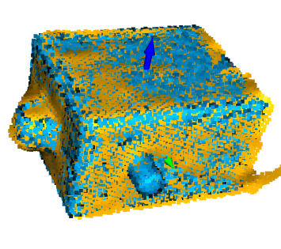
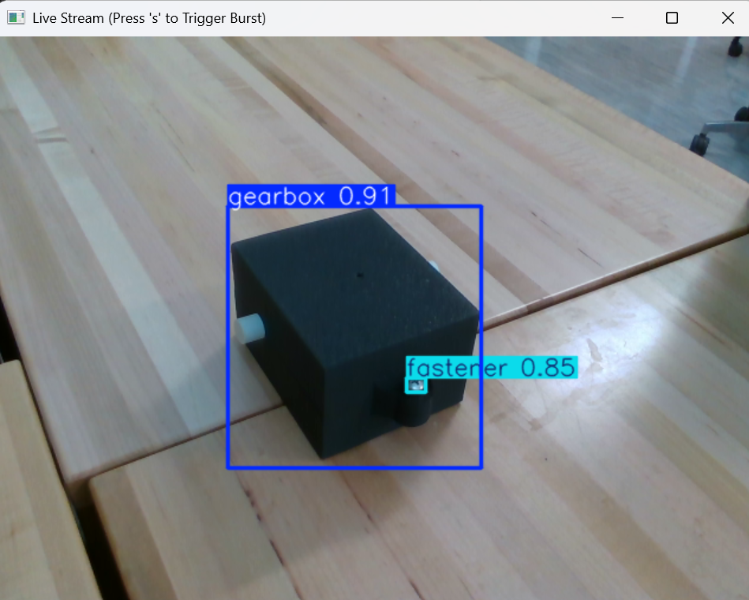

# HRC Robotic Disassembly

A containerized ROS 2 framework and 3D perception pipeline for human-robot collaborative disassembly of a gearbox with a UR5e arm and an Intel RealSense RGB-D camera. It was developed in Dr. Hongyue Sun's lab at the University of Georgia.






## What's in this repo

| Component | Status | Description |
|---|---|---|
| Docker environment | Done | Reproduces the Jetson target (Ubuntu 22.04, ROS 2 Humble, Python 3.10) on any dev machine |
| ROS 2 workspace | Done | Package layout, launch files, and custom interfaces for the pipeline |
| 3D registration pipeline | Done (offline) | CAD-to-scene 6D pose estimation from RGB-D data |
| Foxglove integration | Done | Live point clouds, camera streams, and topic telemetry over WebSocket |
| Perception, state machine, and motion nodes | In progress | Being built on top of this framework |

## 3D registration pipeline

The pipeline estimates the gearbox's 6D pose by aligning its CAD model to RealSense depth data:

1. **Detection:** a YOLO model locates the gearbox and gives a bounding-box region of interest.
2. **Depth denoising:** 25 depth frames are captured and median-filtered per pixel, then a bilateral filter smooths surfaces while keeping edges.
3. **ROI cropping and downsampling:** the depth is cropped to the padded box, converted to a point cloud, and voxel-downsampled at 1 mm.
4. **Background and outlier removal:** RANSAC plane segmentation removes the table. Statistical outlier removal and two radius-outlier passes (a coarse one, then a fine one) remove stray clusters and edge noise.
5. **Global registration:** normals oriented toward the camera, FPFH features, then RANSAC for an initial pose.
6. **Local refinement:** multi-scale ICP over 5 stages with a shrinking correspondence distance.

**Tech:** ROS 2 Humble, Docker, Python, Open3D, NumPy, OpenCV, YOLO, Intel RealSense SDK, Foxglove Studio

## Repository structure
 
```
.
├── 3D Segmentation/            # original 3D registration prototypes
│   ├── cube_prototype/
│   └── gearbox_prototype/      # registration scripts, matrix configs
├── ROS2/
│   ├── docker/                 # Dockerfile, docker-compose.yml, requirements
│   └── ros2_ws/src/
│       ├── gearbox_interfaces/ # custom action and service definitions
│       └── gearbox_perception/ # nodes, utils, resources, launch files
└── assets/                     # images used in this README
```

## Quickstart

**Requirements:** Docker Desktop, plus Foxglove Studio for visualization.

```bash
# 1. Start the container (first run builds the image)
cd ROS2/docker
docker compose up --build -d      # later runs: docker compose up -d

# 2. Open a shell inside it
docker exec -it ros2_dev_container /bin/bash

# 3. Build and source the workspace (from /ros2_ws)
colcon build
source install/setup.bash

# 4. Launch the pipeline
ros2 launch gearbox_perception perception_pipeline.launch.py
```

**Visualize:** in Foxglove Studio, choose Open Connection → Foxglove WebSocket → `ws://localhost:8765`.

**Shut down:** press `Ctrl+C`, type `exit`, then run `docker compose down`.

<details>
<summary>Windows: freeing memory from Docker and WSL</summary>

Quit Docker Desktop from the system tray (the show-hidden-icons arrow → right-click Docker → Quit Docker Desktop). If WSL is still running, check with:

```bash
wsl --list --running
```

If any distributions are listed, shut them down:

```bash
wsl --shutdown
```
</details>

## Contributions

- **Zach Smith:** designed the system architecture and node design (perception, 3D registration, state management, motion execution), built the Docker environment, ROS 2 workspace (package structure, launch files, custom interfaces), the Foxglove integration, and the 3D registration pipeline (data collection, YOLO training, depth filtering, FPFH + RANSAC + ICP).
- **Minh "Arthur" Nguyen:** implementing the ROS 2 nodes from that design, including the perception node and the path planning and motion execution components (MoveIt and the UR5e driver).


Advisor: Dr. Hongyue Sun, University of Georgia.

## Release history

- `v1.0-registration-framework`: Docker + ROS 2 framework and the offline 3D registration pipeline.
