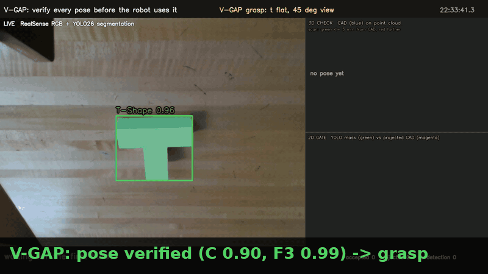
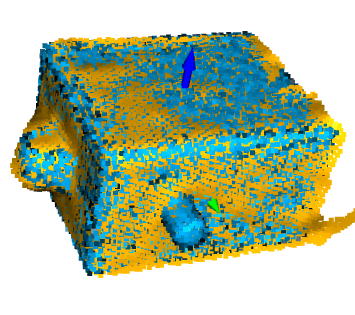
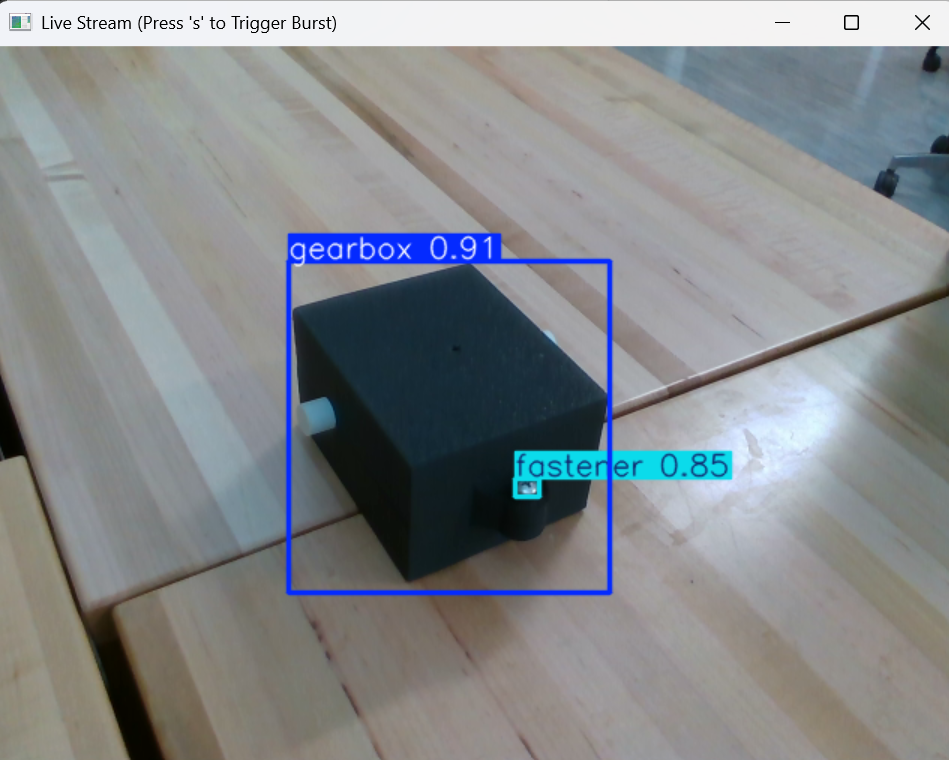

# HRC Robotic Disassembly

A containerized ROS 2 framework and 3D perception pipeline for human-robot collaborative disassembly with a UR5e arm and an Intel RealSense RGB-D camera, developed in Dr. Hongyue Sun's MERIT Lab at the University of Georgia.

## Featured: V-GAP, Visually Gated Active Perception

**V-GAP verifies every pose estimate before the robot uses it, and moves the wrist camera when verification fails.** It projects the CAD model into the image at the estimated pose, checks it against the YOLO mask and the depth (a cross-modal consistency gate), and releases the pose only if every check passes; otherwise a gate-triggered recovery sequence re-views the part, and if no view passes, nothing is released.



- **1,920 real captures** of four parts in three surface finishes (1,440 at 0/30/45 degree views, 480 at 60 degrees): plain RANSAC+ICP would have sent 924 wrong poses to the robot (644 + 280); V-GAP accepted 1,711 poses with 3 wrong (all at 0-45 degrees), and none wrong with the 3D check.
- **Grasp trials:** parts held after 39 of 40 V-GAP grasps (97.5%) vs 15 of 40 plain RANSAC+ICP grasps (37.5%), exact McNemar p = 1.2e-7.
- **Occlusion tests** (one or two occluders): recovery produced a correct verified pose in all 40 trials, with no wrong pose accepted.
- **Gocator 3210 ground-truth check** on 160 captures of the white parts: no wrong accepted pose; operator and Gocator grades agree on 159 of 160.

Code, CAD, results and method: [`V-GAP/`](V-GAP/README.md).

## What's in this repo

| Component | Status | Description |
|---|---|---|
| Docker environment | Done | Reproduces the Jetson target (Ubuntu 22.04, ROS 2 Humble, Python 3.10) on any dev machine |
| ROS 2 workspace | Done | Package layout, launch files, and custom interfaces for the pipeline |
| 3D registration pipeline | Done (standalone) | CAD-to-scene 6D pose estimation from RGB-D data; not yet connected to ROS 2 (future work) |
| Foxglove integration | Connected | WebSocket bridge to Foxglove Studio is set up and working; no perception data streams through it yet because the perception node is not built, and the custom UI is not built yet |
| Path planning / motion node | In progress | MoveIt and the UR5e driver, being built on top of this framework |
| Perception and state machine nodes | Planned | Not started yet |
| V-GAP (Visually Gated Active Perception) | Done (tested on UR5e) | Pose estimation with a cross-modal consistency gate before every grasp, gate-triggered recovery, calibration and full evaluation. See [`V-GAP/`](V-GAP/README.md) |

## Earlier work: ROS 2 framework and gearbox registration






## 3D registration pipeline

The pipeline estimates the gearbox's 6D pose by aligning its CAD model to RealSense depth data:

1. **Detection:** a YOLO model locates the gearbox and gives a bounding-box region of interest.
2. **Depth denoising:** 25 depth frames are captured and median-filtered per pixel, then a bilateral filter smooths surfaces while keeping edges.
3. **ROI cropping and downsampling:** the depth is cropped to the padded box, converted to a point cloud, and voxel-downsampled at 1 mm.
4. **Background and outlier removal:** RANSAC plane segmentation removes the table. Statistical outlier removal and two radius-outlier passes (a coarse one, then a fine one) remove stray clusters and edge noise.
5. **Global registration:** normals oriented toward the camera, FPFH features, then RANSAC for an initial pose.
6. **Local refinement:** multi-scale ICP over 5 stages with a shrinking correspondence distance.

**Tech:** ROS 2 Humble, Docker, Python, Open3D, NumPy, OpenCV, YOLO (Ultralytics), Intel RealSense SDK, UR RTDE, Gocator SDK, Foxglove Studio

## Repository structure
 
```
.
├── 3D Segmentation/            # original 3D registration prototypes
│   ├── cube_prototype/
│   └── gearbox_prototype/      # registration scripts, matrix configs
├── ROS2/
│   ├── docker/                 # Dockerfile, docker-compose.yml, requirements
│   └── ros2_ws/src/
│       ├── gearbox_interfaces/ # custom action and service definitions
│       └── gearbox_perception/ # nodes, utils, resources, launch files
├── V-GAP/                      # Visually Gated Active Perception: code/vgap, cad, results, docs (see V-GAP/README.md)
└── assets/                     # images used in this README
```

> **Hardware-specific files are not included.** V-GAP ran on the lab's Jetson with a UR5e, a wrist RealSense, a Gocator 3210 and a Robotiq 2F-140. The hand-eye matrices (specific to that robot and mount), the Gocator SDK and its wrapper scripts (`Gocator.py`, `GoSdk_MsgHandler.py`, licensed by LMI) stay on the lab machine, which is what paths like `../Python Files Disassembly/...` in `V-GAP/` point to. With your own setup, recalibrate with `code/vgap/calibrate_hand_eye_ur5e.py` and pass `--hand-eye`. Without any hardware, `python code/vgap/test_vgap_pipeline_sim.py` runs the pipeline on simulated scans. The YOLO weights are included in V-GAP/weights/.

## ROS 2 quickstart

**Requirements:** Docker Desktop, plus Foxglove Studio for visualization.

```bash
# 1. Start the container (first run builds the image)
cd ROS2/docker
docker compose up --build -d      # later runs: docker compose up -d

# 2. Open a shell inside it
docker exec -it ros2_dev_container /bin/bash

# 3. Build and source the workspace (from /ros2_ws)
colcon build
source install/setup.bash

# 4. Launch the pipeline
ros2 launch gearbox_perception perception_pipeline.launch.py
```

**Visualize:** in Foxglove Studio, choose Open Connection → Foxglove WebSocket → `ws://localhost:8765`. The connection works; perception topics will appear once the perception node is built.

**Shut down:** press `Ctrl+C`, type `exit`, then run `docker compose down`.

<details>
<summary>Windows: freeing memory from Docker and WSL</summary>

Quit Docker Desktop from the system tray (the show-hidden-icons arrow → right-click Docker → Quit Docker Desktop). If WSL is still running, check with:

```bash
wsl --list --running
```

If any distributions are listed, shut them down:

```bash
wsl --shutdown
```
</details>

## Contributions

- **Zach Smith:** for V-GAP, designed the original RANSAC + ICP pose pipeline and its design choices, designed the new adaptive recovery, trained the YOLO model, and did all of the physical work (robot and sensor setup, calibration, and every test and experiment on the UR5e). For the framework, designed the system architecture and node design (perception, 3D registration, state management, motion execution), built the Docker environment, ROS 2 workspace (package structure, launch files, custom interfaces), the Foxglove connection, and the standalone 3D registration pipeline (data collection, YOLO training, depth filtering, FPFH + RANSAC + ICP).
- **Minh "Arthur" Nguyen:** implementing the path planning and motion execution node from that design (MoveIt and the UR5e driver).
- **Nitesh Silwal** (PhD student, MERIT Lab): came up with the original V-GAP idea of gating poses with a 2D YOLO mask check and adaptive viewpoint recovery, first aimed at depth holes and missing pixel depth.


Advisor: Dr. Hongyue Sun, MERIT Lab, University of Georgia.

## Acknowledgments

Thanks to Dr. Hongyue Sun and Nitesh Silwal (PhD student, College of Engineering) of the MERIT Lab at the University of Georgia for their guidance, insight and help throughout V-GAP and with the paper.

## Release history

- `v1.0-registration-framework`: Docker + ROS 2 framework and the offline 3D registration pipeline.
- V-GAP: Visually Gated Active Perception, evaluation and results (`V-GAP/`).
