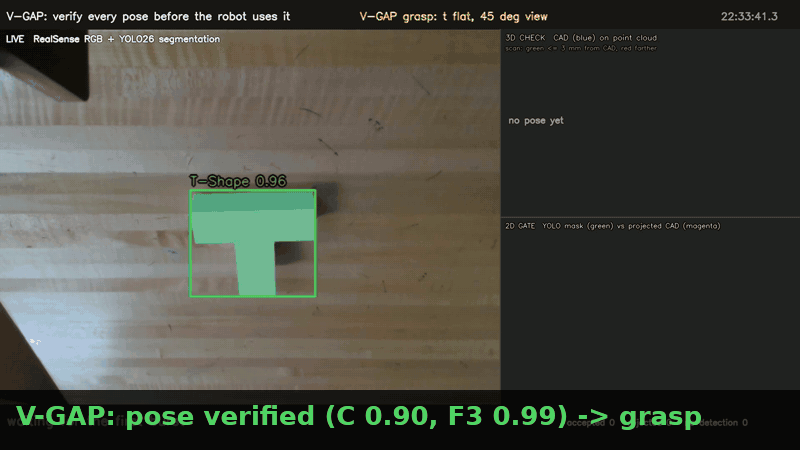
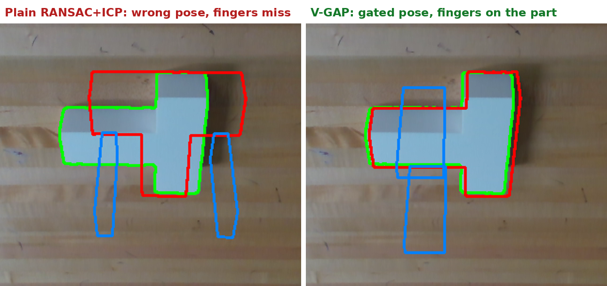
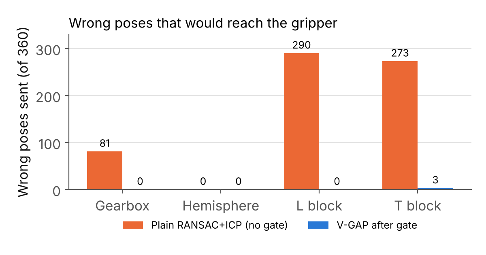
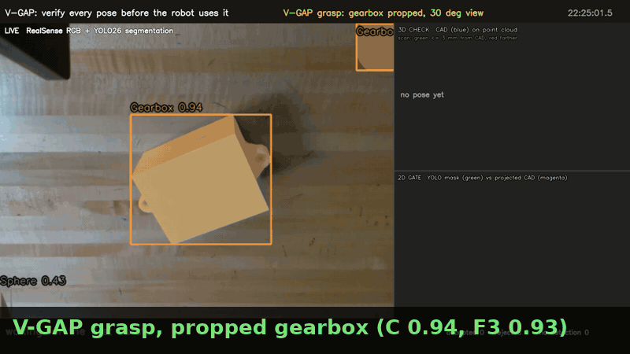
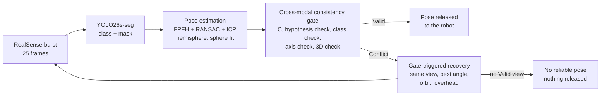
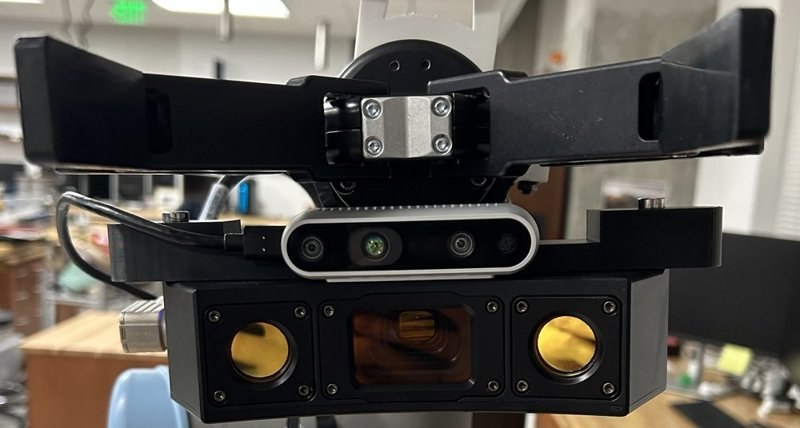
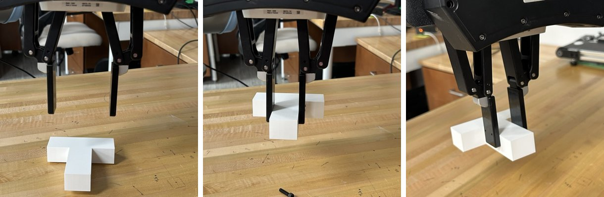
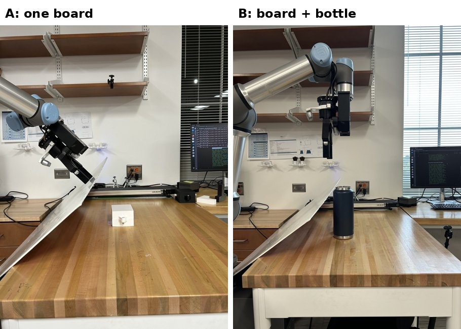

# V-GAP: Visually Gated Active Perception for Cross-Modal Pose Verification and Viewpoint Recovery

**V-GAP verifies every pose estimate before the robot uses it, and moves the wrist camera when verification fails.** RGB-D registration pipelines always return a pose, even when it is wrong: on near-symmetric parts, FPFH-RANSAC-ICP often converges to a pose rotated by 90 or 180 degrees that fits the depth almost as well as the correct one, and an open-loop pipeline passes it to the robot unchecked. V-GAP projects the CAD model into the image at the estimated pose, compares it with the YOLO mask and the depth (a cross-modal consistency gate), and releases the pose only if every check passes. Otherwise a gate-triggered recovery sequence re-views the part, and if no view passes, nothing is released.

Built and tested on a UR5e with a wrist-mounted Intel RealSense, a Robotiq 2F-140 gripper, and a Gocator 3210 3D sensor for an independent ground-truth check. Developed in Dr. Hongyue Sun's MERIT Lab at the University of Georgia.


*Live demo from the wrist camera, same T-block placement. Left: RealSense image with the YOLO mask. Right: the 3D check (CAD on the scan, red = points more than 3 mm off) and the 2D gate (YOLO mask vs projected CAD). V-GAP verifies the pose before the grasp; plain RANSAC+ICP sends a wrong pose unchecked.*

## Results at a glance

1,920 real captures of four parts in three surface finishes: 1,440 at 0, 30 and 45 degree views, plus 480 at a 60 degree view outside the calibration range.

| Test | Plain RANSAC+ICP | V-GAP |
|---|---|---|
| **Main evaluation**, 0/30/45 degrees (1,440 captures) | 644 wrong poses would reach the robot | 1,287 accepted, 3 wrong (0.23%); **0 wrong** with the 3D check applied to the recorded data |
| **60 degree view**, outside the calibration range (480 captures) | 280 wrong poses (of 479 with a detection) | 424 accepted, **0 wrong** |
| **All views combined** (1,920 captures) | 924 wrong poses | 1,711 accepted, 3 wrong as run; **0** with the 3D check |
| **Occlusion tests**, one occluder (board) and two occluders (board + water bottle), 40 trials | Not tested: no recovery, and the hidden part gave no detection from the first view | **40/40** recovered with a correct verified pose, 0 wrong accepted |
| **Gocator 3210 ground-truth check**, white parts (160 captures) | 94 wrong | 159 accepted, **0 wrong**; operator and Gocator grades agree on 159 of 160 |
| **Grasp trials**, 80 paired trials (40 per method) | Parts held after 15/40 (37.5%) | Parts held after **39/40 (97.5%)**, every attempted grasp held |

Grasp trials: on the paired placements, 24 succeeded with V-GAP only and none with plain only (exact McNemar p = 1.2e-7). A smaller stress test on the reflective T-block found 1 wrong accepted pose among 25 graded captures. The cost of the gate is caution: about 9% of correct poses were rejected in the main evaluation, mostly on reflective filament.


*Grasp plans for the same flat T-block placement at a 45 degree view. Green: YOLO mask. Red: CAD at the estimated pose. Blue: gripper fingers. Left, plain RANSAC+ICP: the CAD is rotated, so the fingers would close diagonally across the part (the operator stopped the trial). Right, V-GAP: the CAD matches the part, the fingers close across the stem, and the part was lifted and held.*




*V-GAP grasping the gearbox propped on a screw, 30 degree view (approach sped up 3x). The pose passes the gate before the arm moves.*

## How it works



1. **Object segmentation.** A YOLO26s-seg model gives the class, which selects the CAD model and per-object settings, and the instance mask, which crops the depth and is the 2D evidence for the gate.
2. **Pose estimation.** Depth is captured as a burst of 25 frames (emitter 150 mW, exposure 4,000 us, chosen from a laser/exposure sweep) and kept only inside the eroded mask. FPFH + RANSAC gives a coarse pose and ICP refines it. The hemisphere uses a sphere fit with the known radius plus an axis search instead. For the gearbox, L-block and T-block, a table-based fallback places the CAD upright on the table at yaw steps of 15 degrees when the gate returns Conflict.
3. **Cross-modal consistency gate.** The CAD is projected into the image at the estimated pose. A capture is **Valid** only if all of these pass:
   - **Consistency score** C = 0.3 x I_B + 0.7 x I_M (bounding-box and mask overlap with the YOLO detection) reaches the per-object threshold tau_c (gearbox 0.90, L-block 0.85, T-block 0.81, hemisphere 0.85), calibrated on the robot.
   - **Hypothesis check:** the pose rotated about the CAD height axis (90/180/270 degrees) is also scored, and the best candidate must lead the best non-equivalent one by at least 0.10.
   - **Class check:** when YOLO reports an L-block or T-block, both CAD models are registered and the higher C wins (lead of at least 0.10).
   - **Hemisphere axis check:** the axis ambiguity must stay below a limit.
   - **3D check:** F3, the share of scan points within 3 mm of the posed CAD, must be at least 0.7 (hemisphere 0.6). This catches poses that keep the outline but are shifted or tilted in depth.
4. **Gate-triggered recovery** on Conflict: **(0) same view**, one new burst without moving the arm; **(1) best angle**, the object's best-registering tilt (30 degrees for the gearbox, L-block and T-block, 0 degrees for the hemisphere); **(2) orbit**, 90 degrees counter-clockwise around the part at the same tilt; **(3) overhead**, a straight-down view if one has not been tried. If no step gives a Valid pose, nothing is released.

The gate runs per capture. Between captures, the pose is held in the robot base frame through the UR5e kinematics and the hand-eye calibration (no continuous tracking).

## Hardware and test parts


*Wrist of the UR5e: Robotiq 2F-140 gripper (top), the RealSense camera (middle), and the Gocator 3210 used for the ground-truth check (bottom).*

| Part | Size | Why it is hard |
|---|---|---|
| L-block | 100 x 100 x 26.7 mm, arm width 33.3 mm | Easily confused with the T-block by YOLO; rotated poses fit the outline |
| T-block | 100 x 100 x 26.7 mm, arm width 33.3 mm | Same; a 90 degree turn about the stem keeps the outline |
| Hemisphere | 100 mm diameter, 50 mm high | No features for FPFH; a tilted dome has almost the same outline |
| Gearbox housing (two identical lids) | 153 x 90 x 64.8 mm, lips on the short ends | Near-symmetric; 90 degree yaw errors look similar from above |

Each part was 3D printed in white, grey and reflective dark filament.


*Example V-GAP grasp of the white T-block: open fingers above the part, fingers closed across the stem, part lifted and held.*


*Occlusion test setups. Setup A (one occluder): a poster board hides the part from the first view. Setup B (two occluders): a water bottle is added. Recovery produced a correct verified pose in all 40 trials.*

## Repository layout

```
V-GAP/
├── code/vgap/  all scripts (run from V-GAP/: python code/vgap/<script>.py)
├── cad/        CAD models of the four parts (mm)
├── results/    per-run CSVs, reports and figures for every experiment (see results/README.md)
├── docs/       method notes and the exact commands used for each experiment
├── assets/     images used in this README
└── requirements.txt
```

### Main scripts

| Script | What it does |
|---|---|
| `vgap_pipeline.py` | The pipeline: capture, detection filters, pose estimation, table-based fallback, cross-modal consistency gate, same-view retry. Per-object settings in `OBJECT_CONFIGS`. |
| `vgap_gate_eval_ur5e.py` | Robot experiment runner: moves to each view, runs the pipeline, logs every burst, injects wrong poses to test the gate, runs recovery, Gocator ground truth (`--gocator`), static mode (`--static`), and builds reports (`--report`). |
| `vgap_grasp_trials_ur5e.py` | Paired grasp trials, V-GAP vs plain RANSAC+ICP, with the Robotiq 2F-140. |
| `calibrate_tau_c_ur5e.py`, `recommend_tau_c.py` | Collect labelled C values on the robot and pick tau_c per part (zero-false-accept rule). |
| `calibrate_hand_eye_ur5e.py` | Camera hand-eye calibration from an ArUco marker (OpenCV Tsai/Park/Daniilidis/Horaud, keeps the most consistent). |
| `gocator_cam.py`, `gocator_handeye.py`, `gocator_gt.py`, `gocator_regrade.py` | Gocator capture, its hand-eye, independent CAD fit for ground truth, and re-grading of finished runs. |
| `train_seg.py`, `collect_hard_examples.py` | YOLO segmentation training (split by video clip, label checks) and hard-example capture. |
| `apply_3d_check_offline.py`, `make_fig*.py` | Re-analysis and figures. |
| `depth_settings_sweep.py`, `exposure_sweep.py` | RealSense laser/exposure sweeps. |
| `demo_recorder.py` | Split-screen demo video (live YOLO, 2D gate, 3D check) for the eval and grasp scripts (`--demo-video`). |
| `sim_stress_test.py`, `sim_method_compare.py`, `test_*.py` | Simulated RealSense scans: stress test, method comparison, unit tests (no hardware needed). |
| `vgap_trials_ur5e.py` | Earlier trial runner; shared helpers used by the eval and grasp scripts. |
| `vgap_gate.py`, `sim_gearbox_gate.py`, `shift_hand_eye.py` | Early gearbox gate prototype and a small hand-eye utility. |

## Running it

```bash
cd V-GAP
pip install -r requirements.txt

# No hardware: simulated scans through the full pipeline
python code/vgap/test_vgap_pipeline_sim.py

# On the robot (see docs/ for every command used in the experiments)
python code/vgap/vgap_gate_eval_ur5e.py --help
```

Settings passed on the command line: `--robot-ip` (UR5e), `--serial` (wrist RealSense serial), `--hand-eye` (camera hand-eye `.npy`, e.g. `"../Python Files Disassembly/matrix_config/T_flange_cam_updated_zfix.npy"`), `--gocator-ip`, `--gocator-hand-eye`. Outputs go to `data/` under the folder you run from.

Not in the repo:
- **YOLO weights.** The pipeline uses the no-null fine-tune of YOLO26s-seg (mask mAP50 98.3% on the held-out test set). `YOLO_MODEL_PATH` in `vgap_pipeline.py` points to `../Python Files Disassembly/runs/segment/yolo26s_ft_nonull/weights/best.pt`, where it sits on the lab machine; change it if your weights are elsewhere. Train your own with `code/vgap/train_seg.py`.
- **Hand-eye matrices.** Specific to the robot; in the lab they are in `Python Files Disassembly/matrix_config/`. Recalibrate with `code/vgap/calibrate_hand_eye_ur5e.py`.
- **Gocator SDK.** `gocator_cam.py` imports `Gocator.py` and `GoSdk_MsgHandler.py`, which are in `Python Files Disassembly/` in the lab repo, and reads the SDK from `SDK_PATH` (the lab Jetson path). When running `--gocator` from `V-GAP/`, add that folder to the Python path: `PYTHONPATH="../Python Files Disassembly" python code/vgap/vgap_gate_eval_ur5e.py ... --gocator`.
- Raw images and point clouds (too large).

## Limitations

- **Reference:** pose accuracy in the main, 60 degree and occlusion evaluations is measured against an operator-confirmed reference pose. The Gocator check supports this grading on 160 captures of white parts (plus a smaller reflective T-block stress test with one wrong accepted pose).
- **Hand-eye transform:** the evaluations used a hand-measured camera-to-flange transform. The gate works in the camera frame and is unaffected, but base-frame positions drifted with camera tilt; the Gocator check revealed a 6.3 mm offset, which was corrected.
- **Detection:** the detector was trained on handheld-camera images in daytime lighting and was weaker in strong shadow and from arm-camera viewpoints that differed from training.
- **Scope of the gate:** the hypothesis check only rotates about the height axis, so other rotations are left to the 3D check. tau_c was calibrated on white parts; reflective parts showed more false rejections. The only baseline was plain RANSAC+ICP.
- **Grasp trials:** white parts, one gripper, operator not blind to the method.

## Contributions

- **Zach Smith:** designed the original RANSAC + ICP pose pipeline and its design choices; designed the new adaptive recovery (same-view retry, best tilt, 90 degree orbit, overhead view); trained the YOLO model; did all of the physical work: robot and sensor setup, calibration (hand-eye, tau_c, Gocator), and every test and experiment on the UR5e.
- **Nitesh Silwal** (PhD student, MERIT Lab): came up with the original idea of gating poses with a 2D YOLO mask check and using adaptive viewpoint recovery, first aimed at depth holes and missing pixel depth.
- Advisor: Dr. Hongyue Sun, MERIT Lab, University of Georgia.

## Acknowledgments

Thanks to Dr. Hongyue Sun and Nitesh Silwal (PhD student, College of Engineering) of the MERIT Lab at the University of Georgia for their guidance, insight and help throughout V-GAP and with the paper.
